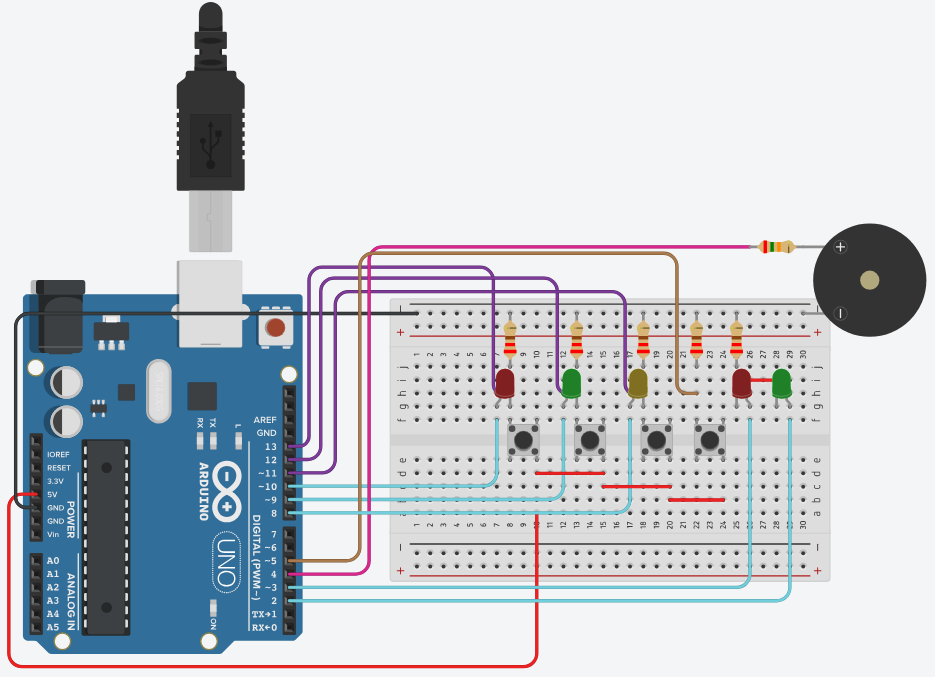
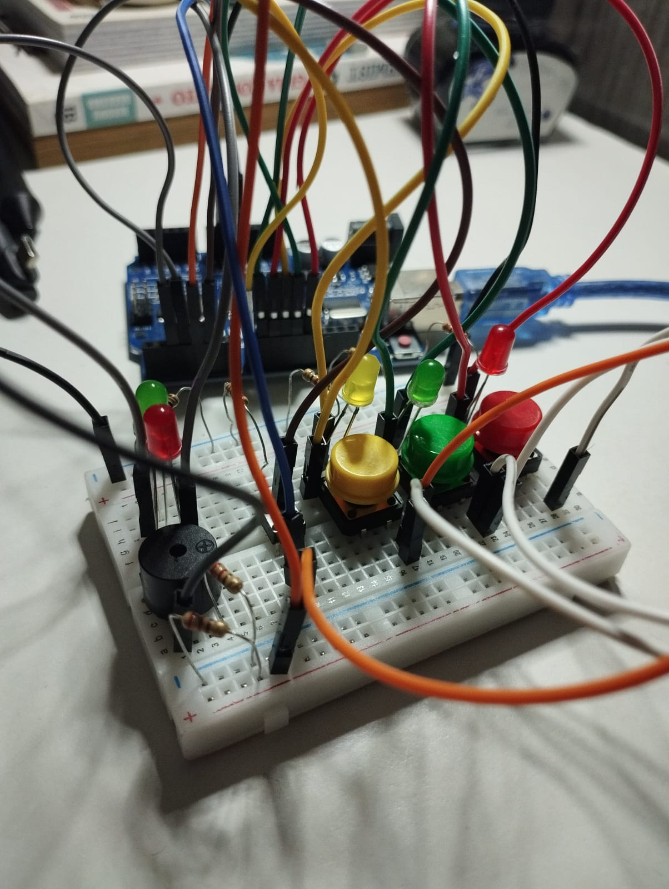

<h1> Jogo da Memória com Arduíno <h1>

<h2 style="text-align: center;">Introdução</h2>

    A primeira versão deste projeto consiste em desenvolver a programação e o circuito de um jogo da memória, para que seja divertido e fácil de montar e, além disto, possa ser compreendido o funcionamento das conexões do arduíno para o funcionamento dos circuitos. Temos como componentes do projeto 1 arduíno, 1 protoboard, 2 leds verde, 1 led amarelo, 2 leds vermelhos, 5 resistores de 220Ω, 4 botões, 1 piezo(buzzer) e 1 resistor de 10kΩ para o controle do volume do piezo(buzzer).

<h2 style="text-align: center;">Montagem</h2>

    A montagem do circuito foi refeita para economizar mais jumpers e entregar o mesmo desempenho no projeto final. Também precisei adaptar para a minha própria protoboard que, devido ao tamanho, é um pouco limitada.
        

       <td></img></td>
       <td></img></td>
    

